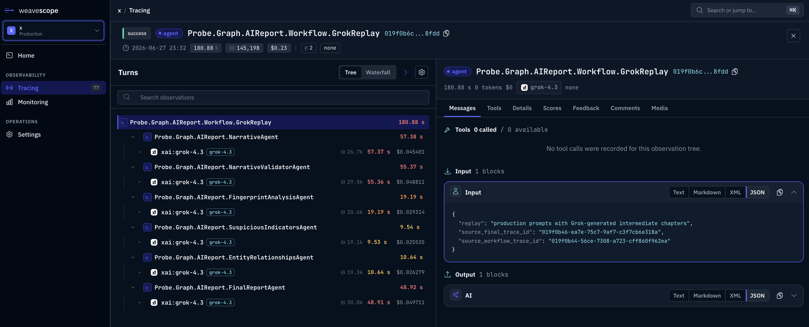

# Tracing

BeamWeaver records every agent and graph run as a tree of runs: the agent, each
model call with its messages and token usage, each tool call, and the
middleware around them. Read the trees in your tests to see what an agent did,
and export them to WeaveScope to follow production traffic.

## Read a trace

Agent and graph runs are recorded without any setup. To get the tree of one
call, wrap it in a run of your own and read that run's tree. This small helper
does both:

```elixir
defmodule MyApp.TraceHelpers do
  alias BeamWeaver.Tracing

  # Runs `fun` inside a new root run and returns its result and the run tree.
  def capture(name, fun) do
    {result, root_id} = Tracing.with_run(name, fn -> {fun.(), Tracing.capture_context().run_id} end)
    {:ok, tree} = Tracing.get_tree(root_id)
    {result, tree}
  end

  # Every run in a tree, each parent before its children.
  def runs(%{run: run, children: children}), do: [run | Enum.flat_map(children, &runs/1)]
end

defmodule MyApp.Tools.LookupOrder do
  use BeamWeaver.Tool

  name "lookup_order"
  description "Look up the shipping status of an order by its id."

  schema do
    field :order_id, :string, description: "The order id"
  end

  @impl true
  def invoke(_tool, %{"order_id" => order_id}, _opts), do: {:ok, "Order #{order_id} shipped on Monday."}
end

defmodule MyApp.SupportAgent do
  use BeamWeaver.Agent

  alias BeamWeaver.Models.FakeChatModel

  model "fake:chat",
    responses: [
      FakeChatModel.tool_call("lookup_order", %{"order_id" => "A-1001"}),
      "Order A-1001 shipped on Monday."
    ],
    usage_metadata: %{input_tokens: 120, output_tokens: 15, total_tokens: 135}

  system_prompt "You are Acme's support agent."
  tools [MyApp.Tools.LookupOrder]
end

{{:ok, _result}, tree} =
  MyApp.TraceHelpers.capture("support_request", fn ->
    MyApp.SupportAgent.invoke(%{messages: ["Where is order A-1001?"]})
  end)

runs = MyApp.TraceHelpers.runs(tree)
for run <- runs, run.kind in [:graph, :model, :tool], do: {run.kind, run.name}
#=> [graph: "MyApp.SupportAgent", model: "fake:chat", tool: "lookup_order", model: "fake:chat"]
```

The agent ran as a graph, called the model, ran `lookup_order`, and called the
model again. Middleware hooks show up as `:chain` runs between them. Each run
is a `BeamWeaver.Tracing.Run` with its `inputs`, `outputs`, `usage`,
`metadata`, `status` (`:ok` or `:error`), `error`, and start and end times:

```elixir
for %{kind: :model, usage: usage} <- runs, do: usage.total_tokens
#=> [135, 135]
```

Local runs are kept in memory on the node, which suits development and tests.
The store keeps every run still in progress and the 10,000 runs that finished
last; older runs make room for new ones, so read a tree soon after its run.
`max_runs:` changes the limit, and `max_runs: 0` keeps only the runs in
progress, which suits a node that exports its traces. A run whose process
exits before finishing it, such as a node or tool killed at its timeout,
finishes then with `status: :error` and the exit reason in `error`, and is
exported as failed. `BeamWeaver.Tracing.clear/0` empties the store, for
example between tests:

```elixir
import Config

config :beam_weaver, tracing: [max_runs: 1_000]
```

To follow production traffic, export runs to WeaveScope.

## What gets traced

| Kind | Recorded for | Holds |
| --- | --- | --- |
| `:graph` | Each agent or graph run, including subgraphs and subagents | The run id, thread and checkpoint in `metadata` |
| `:model` | Each model call | Messages in `inputs` and `outputs`; token counts, cached tokens and costs the provider reports in `usage`; provider, model and tools in `metadata` |
| `:tool` | Each tool call | The arguments the model sent and the tool's result |
| `:chain` | Middleware hooks | The request the hook saw and what it returned |
| Your own | `BeamWeaver.Tracing.with_run/3` and `start_run/2` | What you pass |

Runs started inside another run become its children, also across the tasks in
which graph nodes run, so a subagent's model calls appear under the parent's
`task` tool call. `BeamWeaver.Models.UsageCost.calculate/3` turns `usage` into a
cost with the prices in a model's profile.

## Name and tag a run

Pass `trace:` to `invoke/2`, `stream_events/2` or `resume/2` to name the run
and attach the dimensions you search by:

```elixir
{{:ok, _result}, tree} =
  MyApp.TraceHelpers.capture("support_request", fn ->
    MyApp.SupportAgent.invoke(%{messages: ["Where is order A-1001?"]},
      trace: [
        name: "support_chat",
        user_id: "ada",
        thread_id: "ticket-42",
        execution_mode: "support_chat",
        fields: %{order_id: "A-1001", plan: :pro, api_key: "sk-secret"},
        metadata: %{channel: "email"}
      ]
    )
  end)

[%{run: agent_run} | _] = tree.children
{agent_run.name, Map.take(agent_run.metadata, [:user_id, :custom_fields, :channel])}
#=> {"support_chat", %{user_id: "ada", custom_fields: %{"order_id" => "A-1001", "plan" => "pro"}, channel: "email"}}
```

| Option | Use |
| --- | --- |
| `name:` | The run's name; the default is the agent's name |
| `user_id:`, `session_id:` | Who made the request, and from which session |
| `thread_id:` | The conversation, usually the thread id you pass in `config:` |
| `execution_mode:` | The kind of work, such as `"support_chat"` or `"nightly_report"` |
| `environment:`, `version:` | Where and which release of your app ran it |
| `fields:` | Flat dimensions to filter by, such as ticket or account ids. Values become strings; nested values and keys that look like secrets (`api_key`, `token`, `password`, `secret`, `authorization`) are dropped. |
| `metadata:` | Other details, not indexed |

Model and tool calls inside the run inherit these values, so you can filter
every call of one customer or one ticket. A model you call yourself with
`BeamWeaver.Core.ChatModel.invoke/3` takes `trace_metadata:`, a map added to
that call's run and never sent to the provider. The summaries that
`Summarization` and the `compact_conversation` tool ask for carry
`source: :summarization` or `source: :compact_conversation` this way.

## Trace your own code

`BeamWeaver.Tracing.with_run/3` records any block of code as a run, such as a
call to your CRM, and fails the run if the code raises. For outputs, start and
finish the run yourself:

```elixir
alias BeamWeaver.Tracing

{:ok, run} = Tracing.start_run("load_customer", kind: :tool, inputs: %{customer_id: "ada", api_key: "sk-live-123"})
{:ok, run} = Tracing.finish_run(run, outputs: %{plan: "pro"})

{run.status, run.inputs}
#=> {:ok, %{customer_id: "ada", api_key: "**REDACTED**"}}
```

A run belongs to the process that started it. `BeamWeaver.Tracing.async/2`
starts a task that carries the current run along, so runs inside the task
nest under it; pass `supervisor:` to start it under your `Task.Supervisor`.

## Redaction

Before a run is stored or exported, values that look like secrets are replaced
with `"**REDACTED**"`: map keys such as `api_key`, `authorization`, `password`,
`secret`, `credential` and `token` (token counts stay), bearer tokens, `sk-`
keys, credentials in URLs and secret query parameters. Tool runs record only
the arguments the model sent, never the injected state, store or context.

Redaction doesn't touch personal data: an email address in a message is traced
as it is. Remove it before the model sees it with the PII middleware (see
[Guardrails](guardrails.md#redact-personal-data)).

## Export to WeaveScope

[WeaveScope](https://weavescope.com) shows the run trees with their inputs,
outputs, token usage and costs, and lets you search them by the trace fields:



Set the endpoint and a project API key in `config/runtime.exs`. Without a key,
nothing is exported:

```elixir
import Config

config :beam_weaver,
  weave_scope: [
    endpoint: "https://app.weavescope.com",
    api_key: System.get_env("WEAVESCOPE_API_KEY"),
    otp_app: :my_app
  ]
```

| Option | Meaning | Default |
| --- | --- | --- |
| `otp_app:` | The application whose version is sent with each trace | `:beam_weaver` |
| `batch_size:` | Observation events per upload | `200` |
| `max_items:` | Observation events waiting in memory for upload | `100_000` |
| `max_attempts:` | Upload attempts before a run becomes a dead letter | `5` |
| `overflow:` | When the buffer is full: `:block` makes callers wait; `:drop_oldest` or `:drop_newest` drops a run instead | `:block` |
| `shutdown:` | Milliseconds the queue keeps uploading when the application stops | `120_000` |

A supervised queue uploads in the background, so a run doesn't wait for
WeaveScope. It retries failed uploads and keeps runs that WeaveScope rejects
as dead letters. With the default `overflow: :block`, a long outage that fills
the buffer makes agent runs wait for room rather than lose usage data.
`BeamWeaver.Tracing.Exporters.WeaveScope.Queue.stats/1` reports the backlog:

```elixir
BeamWeaver.Tracing.Exporters.WeaveScope.Queue.stats()
#=> %{queued: _, inflight_batches: _, blocked_producers: _, dead_letters: _}
```

When your application stops, the queue uploads the runs still queued before
it exits, for up to its `shutdown:` time. A script stops without shutting the
application down, so a script that exits right after a run should call
`BeamWeaver.Tracing.flush_exporter/1` first.

## Verify export delivery locally

A local receiver can check the real HTTP request without a hosted account.
From a repository checkout, load the one-request receiver and send an
observation through the actual exporter:

```elixir
Code.require_file("examples/support/http_receiver.exs")

{endpoint, receiver} = BeamWeaver.Examples.HTTPReceiver.start()
{:ok, run} = BeamWeaver.Tracing.start_run("documentation-export", exporter: nil)
{:ok, run} = BeamWeaver.Tracing.finish_run(run, outputs: %{answer: "Ready"})
:ok = BeamWeaver.Tracing.Exporters.WeaveScope.export(:ok, run,
  endpoint: endpoint, api_key: "local-documentation-fixture")

request = Task.await(receiver, 10_000)
true = request.method == :POST
true = request.path == "/api/v1/observations/batch"
[event] = request.body["events"]
true = event["observation_id"] == run.id
```

This verifies serialization and HTTP delivery. Hosted authentication and
project permissions still depend on your WeaveScope account. The receiver
closes after one request and retains no data.

## Your own exporter

An exporter implements `BeamWeaver.Tracing.Exporter`. It receives each run when
it starts (`:started`) and when it ends (`:ok` or `:error`), already redacted.
A configured exporter replaces WeaveScope, and an exporter that raises never
breaks the run. It runs in the process of the run, so hand slow work to another
process. When that process exits before the run ends, such as a tool killed at
its timeout, the `:error` event comes from another process, with
`error: %{kind: :exit, reason: ...}`. This one logs slow model calls:

```elixir
defmodule MyApp.SlowModelCalls do
  @behaviour BeamWeaver.Tracing.Exporter

  require Logger

  @impl true
  def export(:ok, %BeamWeaver.Tracing.Run{kind: :model} = run, _opts) do
    ms = DateTime.diff(run.ended_at, run.started_at, :millisecond)
    if ms > 5_000, do: Logger.warning("#{run.name} took #{ms} ms, #{run.usage[:total_tokens]} tokens")
    :ok
  end

  def export(_event, _run, _opts), do: :ok
end
```

```elixir
import Config

config :beam_weaver, tracing: [exporter: MyApp.SlowModelCalls]
```

## Metrics with telemetry

BeamWeaver emits `:telemetry` events that you can count and alert on:

| Event | Measurements | Metadata |
| --- | --- | --- |
| `[:beam_weaver, :graph, :start]` | `system_time`, `monotonic_time` | `graph`, `run_id` |
| `[:beam_weaver, :graph, :stop]`, `:interrupt`, `:parent_command` | `duration`, `system_time`, `monotonic_time` | `graph`, `run_id`; `:interrupt` adds the interrupt's fields, such as `nodes`, and `:parent_command` the `command` |
| `[:beam_weaver, :graph, :exception]` | `duration`, `system_time`, `monotonic_time` | `graph`, `run_id`, `error` |
| `[:beam_weaver, :graph, :node_start]` | `system_time`, `monotonic_time` | `graph`, `node`, `step` |
| `[:beam_weaver, :graph, :node_stop]` | `duration`, `system_time`, `monotonic_time` | `graph`, `node`, `step` |
| `[:beam_weaver, :graph, :node_failure]`, `:node_timeout`, `:node_exit` | `count` | `graph`, `node`, `step`, `error` |
| `[:beam_weaver, :graph, :step_timeout]`, `:run_timeout` | `duration` | `node`, `step`, `error` |
| `[:beam_weaver, :graph, :retry]` | `count` | `attempt`, `error` |
| `[:beam_weaver, :graph, :cache_hit]`, `:cache_miss` | `count` | `graph`, `node`, `step` |
| `[:beam_weaver, :agent, :model_retry, :retry]`, `[:beam_weaver, :agent, :tool_retry, :retry]` | `attempt` | `error` |
| `[:beam_weaver, :cache, :hit]`, `:miss`, `:put`, `:sweep` | `count` | `adapter`, `namespace`, `result` |
| `[:beam_weaver, :checkpoint, :put]`, `:fetch_tuple`, `:prune` | `count` | `adapter`, `thread_id`, `result`, `error` |
| `[:beam_weaver, :memory, :put]`, `:get`, `:search`, `:sweep` | `count` | `adapter`, `namespace`, `result` |
| `[:beam_weaver, :models, :param_warning]` | `count` | `provider`, `model`, `params` |
| `[:beam_weaver, :provider, :unsupported_feature]` | `count` | `provider`, `model`, `features` |
| `[:beam_weaver, :weave_scope, :queue, :upload_failure]`, `:retry`, `:dead_letter`, `:drop` | `count` | `run_id`, `reason`, `error` |

Attach the handlers once, for example in your application's `start/2`:

```elixir
defmodule MyApp.Metrics do
  require Logger

  @events [
    [:beam_weaver, :graph, :exception],
    [:beam_weaver, :graph, :node_timeout],
    [:beam_weaver, :agent, :model_retry, :retry],
    [:beam_weaver, :weave_scope, :queue, :dead_letter]
  ]

  def attach, do: :telemetry.attach_many("my-app-beam-weaver", @events, &__MODULE__.handle_event/4, nil)

  def handle_event(event, measurements, metadata, _config) do
    Logger.warning("#{inspect(event)} #{inspect(measurements)} #{inspect(Map.get(metadata, :error))}")
  end
end
```

Every graph run, a subgraph's included, sends `:start` and then one of
`:stop`, `:interrupt`, `:exception` or `:parent_command` (a subgraph that hands
a `BeamWeaver.Graph.Command` to its parent). The `duration` of a run or a node
is in native time units; convert it with
`System.convert_time_unit(duration, :native, :millisecond)`. The timeout events
report the limit that ran out, in milliseconds. For model calls and tokens,
read the runs, for example in an exporter like the one above.

## Provider HTTP requests

Provider calls go through Req and Finch, so Finch's own events report each
request: `[:finch, :request, :stop]` with its `duration`, `[:finch, :recv, :stop]`
with the response status, and `[:finch, :request, :exception]`. BeamWeaver puts
a redacted summary in `metadata.request.private[:beam_weaver]`: the provider,
method, URL, timeout, headers and a summary of the body:

```elixir
defmodule MyApp.ProviderLatency do
  require Logger

  def attach, do: :telemetry.attach("my-app-provider-latency", [:finch, :request, :stop], &__MODULE__.handle_event/4, nil)

  def handle_event([:finch, :request, :stop], %{duration: duration}, %{request: request}, _config) do
    with %{provider: provider} <- request.private[:beam_weaver] do
      Logger.info("#{provider} answered in #{System.convert_time_unit(duration, :native, :millisecond)} ms")
    end
  end
end
```

The rest of Finch's metadata holds the raw request and response, including the
API key header, so never log `metadata.request` or `metadata.result` whole.

## Reference

- [`BeamWeaver.Tracing`](https://hexdocs.pm/beam_weaver/BeamWeaver.Tracing.html): runs, run trees, context propagation and flushing
- [`BeamWeaver.Tracing.Run`](https://hexdocs.pm/beam_weaver/BeamWeaver.Tracing.Run.html): a recorded run
- [`BeamWeaver.Tracing.Context`](https://hexdocs.pm/beam_weaver/BeamWeaver.Tracing.Context.html): the current run of a process
- [`BeamWeaver.Tracing.Exporter`](https://hexdocs.pm/beam_weaver/BeamWeaver.Tracing.Exporter.html): the exporter behaviour
- [`BeamWeaver.Tracing.Exporters.WeaveScope.Queue`](https://hexdocs.pm/beam_weaver/BeamWeaver.Tracing.Exporters.WeaveScope.Queue.html): the WeaveScope upload queue
- [`BeamWeaver.Models.UsageCost`](https://hexdocs.pm/beam_weaver/BeamWeaver.Models.UsageCost.html): costs from token usage
